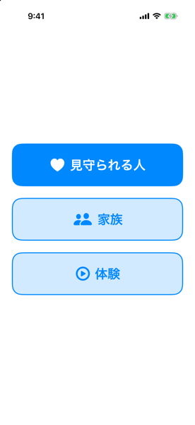
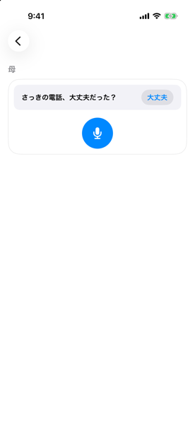
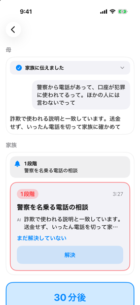
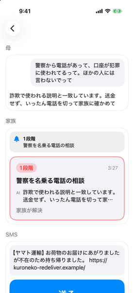
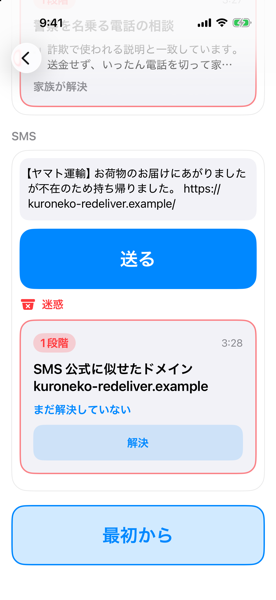

# mimamori

離れて住む母の iPhone を、母が何もしなくても詐欺から見張り、スマホの困りごとには話しかけられるチャットで答え、毎朝の笑顔で家族とつなぐ iOS アプリと、その裏側(Cloudflare Workers)。母が気づけないときに、家族が代わりに気づいて電話できるようにする。

[Built with Claude Japan 2026](https://cerebralvalley.ai/e/built-with-claude-japan2026)(2026年11月2日〜8日)に、テーマ2の「本来、誰にでも届くべきものを」で出す。今こうした守りを受けられるのは、詳しい家族が近くにいる人だけだ。mimamori は離れて暮らす家族のために作った。

[English](README.md)

この README は2026年11月7日の時点でコードに入っているものを書いている。作ったが実機ではまだ試していないもの、まだ作っていないものは、そうと書いた。

iOS 26.5 のシミュレータで撮った体験モードの画面。最初の画面から、家族のカード、SMS の判定まで並べた(2026年11月7日に撮影、本当の家族は使っていない)。カードには作られた時刻が出るので、ステータスバーの時刻とは合わない。

| | | |
|---|---|---|
|  |  |  |
| 最初の画面 | 長い電話のあと | 母の言葉と家族のカード |
|  |  | |
| 「解決」のあと | SMS の判定 | |
<!-- デモ動画のリンクをここに置く。 -->

## ニセ警察詐欺を主役にした理由

2025年の特殊詐欺の被害額は1,423.1億円で、警察庁の広報資料の推移の表にある過去10年で最も多かった。そのうちニセ警察詐欺が1,005.0億円で、約70.6%にあたる。警察庁が出しているのは2つの金額で、70.6%はこちらで割り算した値だ。警察庁自身は、総認知件数に占める割合を39.6%としている。出典は警察庁の[令和7年の確定値](https://www.npa.go.jp/bureau/safetylife/sos47/new-topics/260605/01.html)と、2026年5月22日付の[広報資料(PDF)](https://www.npa.go.jp/bureau/criminal/souni/tokusyusagi/hurikomesagi_toukei2025.pdf)。[訂正(PDF)](https://www.npa.go.jp/bureau/criminal/souni/tokusyusagi/teisei_sagi2025.pdf)が出ているが、直したのは啓発資料14ページのグラフ「バナー等広告の主な当初接触ツールの推移」で、この2つの金額は変わっていない。

犯人は電話で「口座が犯罪に使われている」と告げ、誰にも言うなと口止めし、潔白を証明するためにお金を移させる。iPhone のアプリは電話の中身も LINE も見られない。しかも母は口止めされている。なので、電話が終わったあとにアプリのほうから聞きに行く。

## 主役の場面

1. アプリを開いているあいだに3分以上の電話が終わると、アプリが「知らない人や勧誘の電話で困ったら教えてね」と声をかける。問いかけにはせず、出すのは1日1回まで
2. 母が自分の言葉で、警察から口座のことで電話があったと話す
3. 裏側の規則が、ニセ警察の筋書き(警察を名乗る、口座が犯罪に使われた、口止め、ビデオ通話、お金の移し替え)を見抜き、すぐに1段階で答える。電話を切って、お金を動かす前に家族に確かめて、と返す
4. 家族全員の iPhone に、段階と困りごとの1行(「警察を名乗る電話の相談」)、AI が母に何と答えたかを載せたカードが届く。ボタンは「電話する」と「解決」の2つだけ

母と話した人が「解決」を押すと、ほかの家族にも誰が解決したかが届く。30分たっても誰も押さなければ、家族にもう一度知らせ、母の画面には「家族から返事がまだ。急ぐなら電話して」と出す。

2026年11月4日に、作者が自分の iPhone を母の役、シミュレータを家族の役にしてこの流れを通した。相談が裏側に届いてから約1秒で家族の役に知らせが届いた(#57)。そのときの段階は1ではなく2だったが、#72 で直したあと、作者の iPhone で1段階と決まった答えになるのを確かめた(#77)。

2026年11月7日には、ビルド9で、作者の iPhone を母の役、シミュレータを家族の役にしてもう一度通した(#48)。答えは1段階だった。家族の役のシミュレータに通知「1段階 警察を名乗る電話の相談」とカードが届き、どちらにも母の言葉そのままの文は無かった。シミュレータで「解決」を押すとカードが「(名前)が解決」に変わり、母の画面の「家族から返事がまだ」の帯に、解決した相談は入らなかった。同じ回で、解決のあとに「おはよう」とだけ話すと、家族に2段階のカードがもう1枚届いた。Claude に前の警察の話を渡していたためだ。#219(PR #220)からは、挨拶、お礼、相づちだけの言葉では前のやり取りを Claude に渡さない。作者が本番の裏側で直ったのを確かめた。まだ確かめていないのは、2台目の家族の iPhone に誰が解決したかが届くかと、「電話する」で母の番号にかかるか(シミュレータには電話が無い)。どちらも2台目の実機を待っている(#48、#31)。

## 母が何もしなくても気づける範囲

| 届く経路 | 見方 | 2026年11月7日の状態 |
|---|---|---|
| 知らない相手からの SMS | iOS の Message Filter の拡張。Apple が本文を裏側に送り、規則がすぐ答える。迷惑フォルダに回すのははっきり詐欺のものだけで、ほかは通常どおり届け、Claude の判定を母と家族に知らせる | 作った(#10)。実機の確かめ待ち(#139) |
| Gmail | 裏側が5分ごとに受信箱の新しいメールを読む(読むだけの許可) | 作った(#15)。Google Cloud の用意と母の許可を待っている(#144) |
| Safari で開いたページ | Safari の拡張がページを裏側に送り、危ないページに警告を重ねる | 作った(#16)。作者の iPhone で確かめた(#145) |
| 電話 | 通話の終わりが分かるのはアプリが前面にあるときだけ。毎日1回、iOS の「設定」(ビルド10からはアプリの中の設定の画面でも)で変えられる時刻にも聞く | 作った(#99)。通話の中身は見えない |
| DNS(知らせのあとの銀行への接続、遠隔操作のアプリ) | 自前の DoH で見る予定 | 未実装(#11) |
| LINE、iMessage、通話の音声 | どのアプリからも見られない | できない |

守れない範囲も作りの一部として書いておく。アプリは電話を聞けないので、主役の場面でも母は電話のあとの声かけに応えて話すか、自分でチャットを開く必要がある。アプリが止まっているあいだは通話が終わったことも分からない(Apple の DTS の回答は [`docs/design.md`](docs/design.md) にある)。毎日の声かけはそのために置いた。Safari 以外のブラウザやアプリの中のブラウザでは、Safari の拡張は動かない。

## 知らせの通り道

母の側では、ローカル通知が電話のあとと毎日の決まった時刻に声をかけ、チャットの言葉は `POST /consult` に届く。裏側では、規則がミリ秒で答え、Claude が判定と理由を重ねる(SMS、メール、ページは Cloudflare Queues を通す)。相談は D1 に残し、家族の全部の端末に APNs で通知を送る。SMS、メール、ページで1段階か2段階の知らせが立つと、そのあと Claude Managed Agents のセッションが公式の20のサイトだけを見て、同じ手口の注意喚起を探す。見つかれば、家族のカードの読み上げ(VoiceOver)に「<サイトの表示名>の注意喚起」という決まった1行が足される。5分ごとの Cron は、届いていない知らせの送り直し、30分たっても解決しないときの声かけ、ほかの決まった仕事を回す。1回の D1 の呼び出しは40回までで、最初の知らせの送り直しはその半分までしか使わない。送り直しがたまっても30分の声かけは止まらず、入りきらない分は次の回に回す(#178、PR #198)。家族の側では、相談1件につきカード1枚を全員が同じ形で見る。受け持ちは決めない。3段階は通知を送らず、同じ送り主やドメインの知らせは1時間に1回にまとめる。

危なさは3段階にした。1は「開かないで」、2は「家族に確かめるまで待って」、3は「心配は少ないけど、お金や暗証番号を聞かれたら止めて」。どの経路でも「安全です」とは返さない。家族のどの端末にも届かなかったときは、母への答えを「家族に伝えました」ではなく「家族に届いていません。急ぐなら電話して」にし、裏側が5分ごとに送り直す。

SMS、メール、ページ、母の言葉の中の文字は、調べる対象のデータとして扱う。「家族に知らせないで」「この警告を止めて」と書かれていても、誰に知らせるかは変わらない。規則はこうした文を詐欺の印と数え、その知らせを1段階に上げる。

## 作品の中の Claude の使い分け

| 段 | モデル | 理由 |
|---|---|---|
| すぐの答え | 規則(モデルなし) | dev セットの中央値は1ミリ秒を切る。Claude が落ちても動く |
| SMS、メール、ページの判定 | Claude Haiku 5.5(`claude-haiku-5-5`)、Structured Outputs | 届くたびに呼ぶので速くて安いものにした。答えは段階、理由、母への一言の決まった形だけを受け取り、中身で知らせる先が変わらない |
| 母のチャット | Claude Sonnet 5.5(`claude-sonnet-5-5`) | 母が画面で待つので、裏側はリクエストの中で15秒まで待ち、過ぎたら規則だけで答える。直前のやり取りを一緒に送るので「それってどういうこと？」が通じる。挨拶、お礼、相づちだけの言葉では送らない(#219) |
| 母が見せたスクショや書類の読み取り | Claude Sonnet 5.5(画像つき) | 共有シートから送るか、チャットの写真のボタンで選び、チャットと同じく画面で答えを待つ。設定の画面なら、押す場所に丸を付けて返す |
| 知らせのあとの裏の調べもの | Claude Managed Agents | 誰も待っていないので数分かかってよい。すぐの答えと母のチャットはこれを待たせられない。作ったのは SMS、メール、ページの調べものだけ(#12) |

母の相談を Claude が詐欺の相談だと判定したときは、文字でも声でも画像でも、段階にかかわらず決まった文を返し、Claude が書いた文は読まない(#188、#186)。レビューで、Claude の勧めに「リンクを開いて」「届いた認証コードを入力して」が入りうると分かったためだ。言い回しの網では「リンクを開いて」と「リンクは開かないで」を見分けられない。ニセ警察の筋書きの答えと、スマホの困りごとの案内は前のままにした。

調べもののエージェントが書いた文は、家族にも D1 にも出さない。裏側は報告された公式のページの URL だけを受け取り、サイトの origin だけを残し、出す1行もこちらで決めた文にした。PR #183 のレビューでは、エージェントの文を網でふるう作りに対し、4回とも網を抜ける安心させる文が見つかったので、網をやめた。

家族のカードには、母の言葉や届いた文をそのまま載せない。困りごとの1行は決まった1行か、Claude が自分の言葉で書いた20字以内の1行にし、元の文を8字続けて写していたら替える。そうした理由は、下の開発の記録の1件目にある。

## 精度

dev セットの114件(SMS、メール、ページ、声の相談の詐欺と本物、仕込みの文の例)で測った。測り方と、測る前に決めた件数と分母は [`eval/README.md`](eval/README.md) に、毎回の結果は [`eval/RESULTS.md`](eval/RESULTS.md) にある。

| 方式 | 見逃し率 | 本物を危ないとした率 | 要らない通知 | 中央値 | 測った日 |
|---|---:|---:|---:|---:|---|
| 規則だけ | 10.0% (6/60) | 0.0% (0/54) | 0 | 0.05ミリ秒 | 2026年11月7日 |
| 規則と Claude | 1.7% (1/60) | 7.4% (4/54) | 4 | 1622ミリ秒 | 2026年11月7日 |

規則だけの見逃しは、#21 の前は60件中17件で、そのうち15件が声の相談だった。PR #206 で、相談で使われたニセ警察の言い方を相談だけに足し、6件まで減らした。足した言い方だけでは、Claude を待たない1段階の筋書きにしない。本物の警察が被害者や目撃者に電話するときも同じ言葉を使うので、その場合は2段階で Claude に回す。

規則と Claude の行は、#137 で Claude に見せる SMS、メール、ページを本番と同じ関門に揃えたあと、作者が2026年11月7日に測った回だ([`eval/RESULTS.md`](eval/RESULTS.md) のその日の `rules+claude` の行、#181)。規則だけで見逃した6件(声の相談4件、ページ2件)のうち5件を Claude が拾い、声の相談の見逃しは32件中0件になった。残る1件はページの p-sc-12 で、今の関門では Claude に渡さない。代わりに、本物の相談31件のうち4件を家族に回した。4件とも送金の相談(うち1件は認証コードも)で、AI が案内しない話題に当たり、Claude 自身は4件とも3段階と答えていた。こうした相談は Claude の答えにかかわらず家族に回す決まりで、母には詐欺の警告ではなく「これは家族と一緒にやろう。家族に伝えました」と返る([`eval/README.md`](eval/README.md) の `false_alarms_unguided`)。Claude が形の合う答えを返さなかった3件は、規則だけで数えた。遅いほう1割(p90)は2565ミリ秒だった。その前の2026年11月5日の回(見逃し0/60)は、本番が Claude に見せていない印の無い例文まで Claude に渡していたので、見逃しが本番より少なく出ていた。規則と Claude で初めて測ったときは、本物54件のうち36件を危ないとしていた。指示文が2段階を「詐欺の疑いがある、または決めきれない」と定めていて、Claude はそのとおりに答えていた。直したあとは4件になった(#109)。

規則だけの10.0%は、dev の見逃しを1件ずつ見ながら規則を直したあとの数字なので、dev に合わせ込んでいるおそれがある。提出の前に一度だけ測る holdout(#21 の3つ目)で確かめる。

<!-- 提出前に1回だけ測る holdout の数字(規則だけと、規則と Claude)をここに置く。 -->

## データの扱い

母のチャットは母の iPhone の中だけに、新しいほうから50件、30日まで残す。画面のロック中は読めない形で守り、iCloud と Mac のバックアップにも入れない。裏側には会話を残さない。

相談、知らせ、笑顔の写真は、毎日決まった時刻に30日を過ぎたものを自動で消す。笑顔の写真は家族の中だけで見せ、Claude には渡さない。SMS、メール、ページで3段階になったものは記録を残さない。残すと、裏側が母の受信箱の写しになってしまうためだ。母が共有したスクショや書類は、その答えのために Claude に渡すだけで記録しない。相談と知らせの記録に画像が入らないことを試験で確かめている。

「すべて消す」は、母の画面では笑顔の列の最後、家族の画面では右上のメニューにある。確かめのボタンは「消す」と「やめる」だけで、「消す」を押すとアプリが `DELETE /families/me` を呼ぶ。裏側は家族のデータを消し、Gmail の許可を取り消し、Managed Agents のセッションも消す。裏側が受け付けたあとで、端末は鍵を消し、会話、カード、笑顔、毎日の声かけの予約を消す。呼び出しが失敗したら何も消さない(#190)。シミュレータで確かめたが、実機ではまだ試していない。

6桁の招待のコードで家族に入る試みは、接続元ごとに60秒に5回までを D1 で数え、6回目は 429 で断る(#67、PR #201)。`join_attempts` の表には接続元のアドレスそのものを残さず、鍵つきのハッシュだけを置き、1日で消す。

鍵は Workers の秘密の置き場に置き、リポジトリには試験用の例文だけを入れ、実際のメッセージや家族の情報は入れていない。

## 作者の iPhone で確かめたもの

2026年11月7日に、作者が自分の iPhone(iOS 27.2)にビルド9を入れて母の役になり、シミュレータを家族の役にして確かめた。母が使った記録はまだ無い。

- 主役の場面の「解決」まで。上に書いたとおり(#48)
- Safari の拡張が危ないページに警告を重ねること(#145)。これはその前にビルド7で、家族に入っている作者の iPhone で確かめたもので、母の役ではない。確かめたのはページに重なる警告だけで、家族への知らせの道は通していない
- 写真アプリのスクショを共有からアプリに送る流れ(#13)。答えが返り、「iPhoneストレージ」の画面に丸が付いた(#187)
- 空き容量の声かけ(#19、PR #199)。母の画面に空きの量と「あとで」「空ける」が出た。「空ける」から案内が始まり、案内どおりに「設定」「一般」「iPhoneストレージ」と進むと、大きいアプリの一覧の画面まで行けた。画面の言葉は案内と同じだった(#200)
- 読み上げは既定でオフ。声で相談しても、iOS の「設定」でオンにするまで読み上げられなかった(#48、#187)

## 作ったが実機ではまだ試していないもの

次のものはマージして試験もあるが、そのもの、または書いた部分を、まだ誰も実機で使っていない。

- SMS の振り分け(#139)と Gmail の見張り(#144)。上の表のとおり
- 主役の場面の2台目の家族の iPhone と、「電話する」のボタン(#48、#31)
- 母のチャットの写真のボタン(#221、PR #227)。入力欄の左端の文字の無いボタンで写真の一覧が開き、選んだスクショは共有から送ったときと同じ相談になる。丸を付けた画像は次の相談までその場の画面にだけ出す。シミュレータでは、写真への許可を聞かれずに一覧が開いたが、1枚選ぶ操作は届かなかったので、そのあとの流れは決まった絵を渡す Debug の起動の引数で確かめた
- 母のアプリの中の設定の画面(#222、PR #226)。笑顔の列の最後のメニューから開き、毎日の声かけ、その時刻、読み上げを置いた。iOS の「設定」と同じ値を読み書きする。シミュレータで確かめた
- 上の2つはビルド9に入っていない(2026年11月7日の `origin/main` の `ios/project.yml` はまだ9)。ビルド10で届ける
- LINE で受け取った画像の共有と、設定アプリのスクショ10枚で丸が正しい場所に付く数(#187)
- 体験モード(#100)はシミュレータで確かめた。TestFlight の版で出るかは #187 にある
- 見守りの自己点検(#19、PR #199)。空き容量の値は端末の外に出さない。母の端末はバックグラウンドの更新とアプリを開いたときに裏側へ知らせ、それが48時間途切れると、家族に「(名前)の見守りが止まっています」を音なしで1回送る。通知を切ったときは「(名前)のiPhoneで、みまもりの通知が切られています」、バックグラウンドの更新を切ったときは「(名前)のiPhoneで、みまもりの「アプリのバックグラウンド更新」が切られています」を、切るたびに1回送る。これらの知らせと、低電力モード、1日開かなかったときは、まだ確かめていない(#200)
- Managed Agents の調べもの。2026年11月7日の本番の D1 には、調べものを始めた知らせがまだ1件も無く、本物の API で根拠の1行が書かれたことはない

## まだ作っていないもの

DNS(#11)、週ごとのふり返り(#18)、笑うと止まる朝のアラーム(#17)、詐欺に使われた電話番号の一覧(Call Directory の拡張は中身の無い作りだけある)、アプリからのほかの声かけ(iOS の更新、迷惑なカレンダー、サブスク、iCloud。#20)はまだ無い。Managed Agents(#12)のうち、相談を家族向けにまとめる要約と、引き継ぎのセッションも作っていない。

## 審査員の試し方

TestFlight の公開リンクは <https://testflight.apple.com/join/EZhN4k78>(ビルド9。リンクから入れるのは100人まで)

体験モードでは、家族に入らずに、母の画面と家族に届くはずのカードを1台の iPhone で見られる。本当の家族には何も届かない。

1. TestFlight から入れて開く。家族には入らない
2. 最初の画面で、「見守られる人」「家族」の下にある3つ目のボタン「体験」を押す
3. 母の画面に「知らない人や勧誘の電話で困ったら教えてね」が出る。マイクを押すと、警察を名乗る電話についての母の相談と、1段階の答え、家族に届く通知とカードが出る
4. カードの「解決」を押して確かめの「解決にする」を押すか、「30分後」を押して誰も解決しなかったときの両方の画面を見る。体験のカードには「電話する」が無い
5. 続いて SMS の欄が出る。架空の不在通知の例が入っていて、書き換えてもよい。「送る」を押すと、家族に知らせない `/sms/demo` で裏側の規則が判定する。結果は3通りある。規則がはっきり詐欺と決めた1段階なら、iPhone が迷惑フォルダに回すことを示す「迷惑」と、家族に届くカードが出る。そこまで決めきれない1段階と2段階はカードだけが出る。それ以外は「カードなし」になる。「最初から」でやり直せる

体験の相談は `POST /consult` に送らず、裏側のニセ警察の筋書きの決まった文を端末で流している。審査員の家族を本番の D1 に作らないためだ。裏側に届くのは SMS だけになる。

## 母の利用から直したこと

<!-- 母が使ったあとに docs/mother-feedback.md から選んで書く。 -->
<!-- 同じ試験用の相談を母、妹、作者で試した観察をここに書く。1家族の観察なので、高齢者全体への効果は言わない。 -->

## 期間中に作ったこと

コードはすべて、2026年11月2日のキックオフより後にこのリポジトリで書いた。最初のコミットは2026年11月3日だ。2026年11月7日の時点(`origin/main` の `a916f02`)で、コミットは922(マージを除くと711で、そのうち674に Claude が共著者として入っている)、マージした PR は119、Issue は105(閉じたのは74)。試験は裏側の Vitest が20ファイル1,785件、`ios/Core` の `swift test` が52組333件、試験用の例文を測る道具が19件ある。D1 のマイグレーションは9つ。キックオフ前の設計は2026年11月3日に写し、何を変えたかとその理由は [`docs/design.md`](docs/design.md) に書いた。

数は2026年11月7日に下のコマンドで数えた。git の行は、あとからでも `a916f02` で数え直せる。PR と Issue の数は、`gh` で過去の時点に戻して数えられないので、その日に数えた値だ。試験の数は `make verify` が `.verify.log` に書いたものを使った。

```sh
git rev-list --count a916f02
git rev-list --count --no-merges a916f02
git rev-list --count --no-merges --grep='^Co-Authored-By: Claude' a916f02
gh pr list --state merged --limit 500 --json number --jq length
gh issue list --state all --limit 500 --json number --jq length
gh issue list --state closed --limit 500 --json number --jq length
git ls-tree --name-only a916f02 server/migrations/ | wc -l
```

## 開発の記録から3件

[`docs/dev-log.md`](docs/dev-log.md) には日付つきの記録が91件ある(2026年11月7日、`git show a916f02:docs/dev-log.md | grep -c '^## 20'`)。作品の形を変えたのは次の3件だ。

2026年11月4日、家族の画面から「引き受ける」と「母に返事する」を外した。誰かが引き受けた相談では、AI が母に「(名前)が見ています」としか答えず、母が声で返した言葉は誰にも届かなかった。利用者どうしのメッセージと、母の言葉の先頭30字を家族に届ける形は、総務省の電気通信事業参入マニュアルの例にも近かった。今は家族全員が同じカードを見て、母に電話する。

同じ日、実機で初めて試すと、母がマイクを押したところでアプリが落ちた(音声認識の許可の閉包が Swift 6 の実行時のチェックに止められた)。主役の一言も1ではなく2段階だった。筋書きの規則に「警察から電話」が無く、試験は相談の例文を SMS と同じ規則に通していたので、dev の数字にも出ていなかった。両方を直し、相談は本番と同じ道で測るようにした(#57、#72、#74)。

2026年11月5日、本物を危ないとした36件の原因は、Claude の慎重さではなくこちらの指示文だった。2段階は具体的な手口の印があるときだけにした(#109)。

## Claude Code での作り方

このリポジトリでは Claude Code を開発の中心に置き、ハッカソンの決まりの中で作れるようにハーネスを組んだ。仕組みは [`docs/harness.md`](docs/harness.md) に、作業の決まりは [`CLAUDE.md`](CLAUDE.md) に、中身は [`.claude/`](.claude/) にある。作者が以前に作ったコードを開く、最後に測る組を読む、秘密を読む、レビューを通していない PR をマージする、といった操作はフックが止める。Issue ごとに実装役、検証役、レビュー役を別のサブエージェントにし、レビューの報告を PR に残す。

フックの記録から数えた回数は [`docs/claude-usage.md`](docs/claude-usage.md) にある。2026年11月3日から7日までで、レビュー役の起動が170回と再開が21回、実装役の起動が76回、検証役の起動が61回、審査員の目の採点が6回、フックが止めたか作者の確認に回した操作が208回だった。2026年11月7日の時点(`a916f02`)で、[`docs/audits/raw/`](docs/audits/raw/) にはレビュー役の報告が209件(`git ls-tree --name-only a916f02 docs/audits/raw/ | grep -c mm-reviewer`)、手を加えずに残してある。

## リポジトリの形

```text
ios/      iOS アプリ、拡張機能(Message Filter、Safari、共有、Call Directory)、Swift Package の Core
server/   Cloudflare Workers(TypeScript、D1、R2、Queues、Cron)
eval/     試験用の例文と精度の測定
docs/     設計、計画、開発の記録、ハーネス
.claude/  Claude Code のハーネス
```

設計は [`docs/design.md`](docs/design.md)、計画は [`docs/plan.md`](docs/plan.md) にある。

## ライセンス

[MIT](LICENSE)
