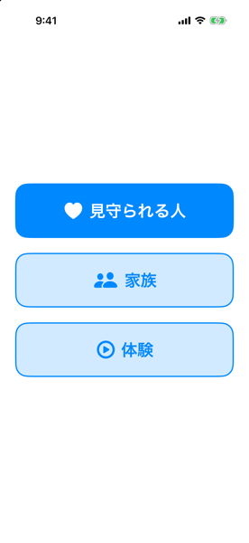
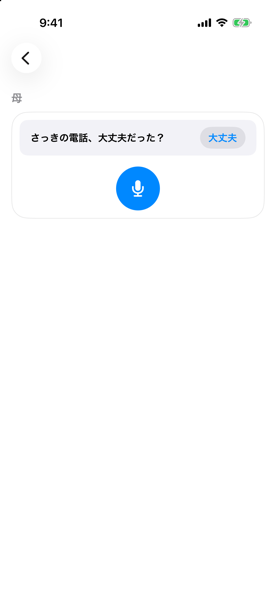
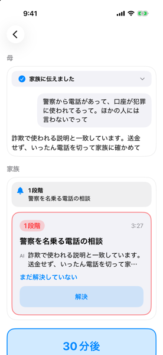
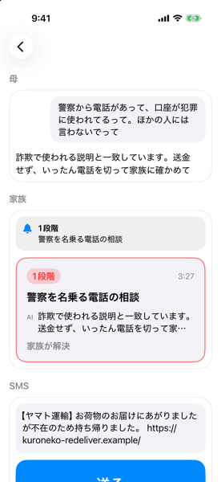
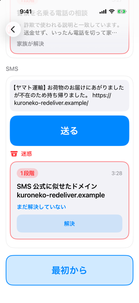

# mimamori

mimamori is an iOS app with a Cloudflare Workers backend. It watches an elderly mother's iPhone for scams without her having to notice them. It answers her phone questions in a chat she can talk to, and lets the family trade a smile every morning. When she cannot tell that something is wrong, the family finds out and calls her.

Built during [Built with Claude Japan 2026](https://cerebralvalley.ai/e/built-with-claude-japan2026) (November 2 to 8, 2026) for theme 2, "本来、誰にでも届くべきものを" (what should reach everyone). Today only people with a tech-savvy relative close by get this kind of protection. mimamori is for families who live apart.

[日本語版](README.ja.md)

This README describes what is in the code on 2026-11-07. Where something is built but not yet tried on a real iPhone, or not built at all, it says so.

These are the demo mode screens on the iOS 26.5 simulator, from the first screen to the family's card and the SMS check (taken on 2026-11-07, without a real family). The card shows the clock time it was made, so it differs from the status bar.

| | | |
|---|---|---|
|  |  |  |
| First screen | After a long call | Her words and the family's card |
|  |  | |
| After 解決 | An SMS judged | |
<!-- Demo video: link goes here. -->

## Why fake-police scams

In 2025, special fraud (特殊詐欺) in Japan took 142.31 billion yen, the highest in the ten years shown in the agency's press release. Fake-police scams (ニセ警察詐欺) took 100.50 billion yen of it, or about 70.6%. The National Police Agency publishes both amounts. The 70.6% is our own division of the two; the agency itself gives the scam's share of reported cases, 39.6%. Sources: the agency's [final figures for 2025](https://www.npa.go.jp/bureau/safetylife/sos47/new-topics/260605/01.html) and the agency's press release of 2026-05-22 ([PDF](https://www.npa.go.jp/bureau/criminal/souni/tokusyusagi/hurikomesagi_toukei2025.pdf)). A [correction (PDF)](https://www.npa.go.jp/bureau/criminal/souni/tokusyusagi/teisei_sagi2025.pdf) fixes one graph on page 14 of the awareness material (「バナー等広告の主な当初接触ツールの推移」, how banner ads first reached victims). It does not change these figures.

The scammer calls and says her bank account was used in a crime. Then they tell her to keep it secret and to move her money to prove she is innocent. An iPhone app cannot listen to calls or read LINE, and the caller has told her to tell no one. So the app comes to her after the call and asks.

## The main scene

1. A call of three minutes or more ends while the app is open. The app asks her: "さっきの電話、大丈夫だった？" (Was that call just now all right?).
2. She says, in her own words, that the police called about her account.
3. Rules on the server recognize the fake-police script (police, account used in a crime, keep it secret, a video call, moving money). They answer at once with level 1: hang up and check with the family before sending any money.
4. Every family member's iPhone gets a card with the level, a one-line topic ("警察を名乗る電話の相談", a consultation about a call from someone claiming to be the police), and what the AI told her. The card has two buttons, Call and Resolve.
5. Whoever talks to her presses Resolve, and the others see who resolved it. If nobody does within 30 minutes, the family is reminded and her screen says the family has not answered yet, call them if it is urgent.

On 2026-11-04 the author ran this on his own iPhone, playing the mother, with a simulator as the family. The notice reached the family about one second after the consultation was sent (#57). That first try came out at level 2. After the fix in #72, the author confirmed level 1 and the fixed answer on his iPhone (#77). The check with two real iPhones is still waiting for the author (#48, #31).

## What it notices without her doing anything

| Channel | How | State on 2026-11-07 |
|---|---|---|
| SMS from unknown senders | iOS Message Filter extension. Apple sends the message to our server, and rules answer at once. Only clear scams go to the junk folder; everything else is delivered, and Claude's judgment reaches her and the family | Built (#10). On-device check pending (#139) |
| Gmail | The server reads new mail in her inbox every 5 minutes (read-only scope) | Built (#15). Waiting for the Google Cloud setup and her consent (#144) |
| Web pages in Safari | A Safari extension sends the page to the server and lays a warning over dangerous pages | Built (#16). Checked on the author's iPhone (#145) |
| Phone calls | The app sees that a call ended only while it is in the foreground. It also asks once a day at a time she can change in Settings | Built (#99). The call itself is never visible |
| DNS (bank sites after a warning, remote-control apps) | Planned as a DoH resolver | Not built (#11) |
| LINE, iMessage, call audio | Not visible to any app | Cannot be done |

What it cannot protect is part of the design. The app never hears the call. In the main scene she still has to answer the question after the call, or start the chat herself. When the app is suspended, it cannot know a call ended (Apple DTS confirms this; see [`docs/design.md`](docs/design.md)), which is why the daily question exists. Other browsers and in-app browsers do not run the Safari extension.

## How a notice travels

- Her side. Local notifications ask about the call and the day. Her chat goes to `POST /consult`.
- The server. Rules decide in milliseconds. Claude adds a judgment and a reason (SMS, mail, and pages go through Cloudflare Queues). The case is stored in D1, and the server sends APNs pushes to every family device.
- Afterwards, for SMS, mail, and pages at level 1 or 2, a Claude Managed Agents session looks for an official warning about the same trick, on 20 official sites only. If it finds one, the family's card gains one fixed line, "<site name>の注意喚起" (a warning from that site), read out by VoiceOver.
- Every 5 minutes a Cron run re-sends undelivered notices, reminds the family after 30 minutes, and does the other scheduled work. Each run makes at most 40 D1 calls, and re-sending first notices may use only half of them, so a backlog cannot stop the 30-minute reminder; what does not fit waits for the next run (#178, PR #198).
- The family side. One card per case, the same for everyone, with no owner or assignee. Level 3 sends no push. The same sender or domain is grouped to one notice an hour.

There are three levels: 1 "don't open it", 2 "wait until you check with the family", and 3 "probably fine, but stop if asked for money or a PIN". The app never says "safe" on any path. If no family device got the notice, her answer says "家族に届いていません。急ぐなら電話して" (the family did not get this; call them if it is urgent) instead of "I told your family", and the server retries every 5 minutes.

Text inside SMS, mail, pages, and her messages is treated as data. A message that says "don't tell the family" or "stop this warning" cannot change who is told. The rules count such a sentence as a scam sign and raise the message to level 1.

## Claude inside the app

| Step | Model | Why |
|---|---|---|
| Instant answer | Rules, no model | Answers in under a millisecond on the dev set, and still works when Claude is down |
| Judging SMS, mail, pages | Claude Haiku 5.5 (`claude-haiku-5-5`), Structured Outputs | Fast and cheap for every message. The reply is a fixed shape (level, reason, one line for her), so nothing in it can change who is told |
| Her chat | Claude Sonnet 5.5 (`claude-sonnet-5-5`) | She waits on screen, so the server waits up to 15 seconds and then answers by rules alone. It remembers the last few turns, so "それってどういうこと？" (what does that mean?) works |
| Reading a screenshot or a document she shares | Claude Sonnet 5.5, with the image | She shares the image from the share sheet and waits for the answer, as in her chat. For a settings screen, the answer comes with a circle on where to tap |
| Research after a warning | Claude Managed Agents | No one is waiting for it, so it can take minutes. The instant answer and her chat must not wait on it. Only the research for SMS, mail, and pages is built (#12) |

When Claude judges her consultation, typed, spoken, or an image, to be about a scam, at any level, she hears a fixed sentence, not Claude's own wording (#188, #186). Reviews found that Claude's advice could contain "open the link" or "enter the code you received", and a word filter cannot tell "open the link" from "don't open the link". The fake-police answer and the answers to ordinary phone questions are unchanged.

The research agent's text never reaches the family or D1. The server takes only the official URLs it reports, keeps only the site's origin, and writes its own line. Four reviews of PR #183 each found a reassuring sentence that slipped past a filter on the agent's words, so the filter was dropped.

Family cards never quote her words or the message she received. The topic is a fixed line or a line of 20 characters or fewer that Claude writes itself. If that line copies 8 or more characters from the source, it is replaced. The reasons were legal and practical; see the dev log entry below.

## Accuracy

Measured on the dev set, 114 examples across SMS, mail, pages, and spoken consultations, with scam and genuine messages plus injection examples. How it is measured, and the counts fixed before measuring, are in [`eval/README.md`](eval/README.md). Every run is a line in [`eval/RESULTS.md`](eval/RESULTS.md).

| Method | Missed scams | Genuine messages flagged | Unneeded family notices | Median time | Measured |
|---|---:|---:|---:|---:|---|
| Rules only | 10.0% (6/60) | 0.0% (0/54) | 0 | 0.05 ms | 2026-11-07 |
| Rules + Claude | 0.0% (0/60) | 7.4% (4/54) | 4 | 1845 ms | 2026-11-05 |

Before #21 the rules alone missed 17 of 60 scams, 15 of them in spoken consultations. PR #206 added the fake-police phrasings those consultations used, for consultations only, and brought the misses to 6. A new phrasing alone does not make the fixed level-1 script, because a real police officer calling a victim or a witness uses the same words, so those go to Claude at level 2.

The rules + Claude line was measured before #137 changed which SMS, mail, and pages reach Claude. That run sent more unflagged examples to Claude than production does now, so its miss rate is lower than production would be. A new run is waiting on the author (#181). The first rules + Claude run flagged 36 of 54 genuine messages. The prompt itself defined level 2 as "suspicious or undecided", and Claude followed it. After the fix, 4 of 54 were flagged (#109).

The 10.0% for rules only was reached by fixing the rules while reading each dev miss one by one, so the rules may be fitted to the dev set. The holdout set, measured once before submission (the third step of #21), will check this.

<!-- Holdout result (measured once before submission) goes here, rules only vs rules + Claude. -->

## Her data

- Her chat stays on her iPhone, up to 50 messages and at most 30 days. The file is unreadable while the phone is locked and is left out of iCloud and Mac backups. The server keeps no chat log.
- Cases, notices, and smile photos are deleted automatically after 30 days, every day at a fixed time.
- Smile photos are shared only inside the family and never sent to Claude.
- SMS, mail, and pages judged level 3 leave no record, so the server does not become a copy of her inbox.
- Screenshots and documents she shares are sent to Claude for that answer and are not stored. A test checks that the stored case and alert rows hold no part of the image.
- "すべて消す" (delete everything) is in the menu on her screen (at the end of the smile row) and on the family's screen (top right). After a confirmation with only "消す" (delete) and "やめる" (cancel), the app calls `DELETE /families/me`. The server removes the family's data, revokes Gmail access, and deletes Managed Agents sessions. Only after the server answers does the phone forget its key and clear the chat, cards, smiles, and scheduled questions. If the call fails, nothing is deleted (#190). Checked on the simulator, not yet on a real iPhone.
- Joining a family with the six-digit invite code is limited to 5 tries a minute per source, counted in D1, and the sixth gets 429 (#67, PR #201). The `join_attempts` table keeps only a keyed hash of the source address, never the address itself, and its rows are deleted after a day.
- Secrets live in Workers secrets. This repository holds only test examples, with no real messages or family details.

## Built, not yet tried on a real iPhone

These are merged and covered by tests, but nobody has used them on a real iPhone yet.

- The SMS filter (#139) and the Gmail watch (#144), as in the table above.
- The main scene with two real iPhones, one for her and one for the family (#48, #31).
- Sharing a screenshot or a document to the app (#13). The share extension and the server side are built and the extension builds for the simulator, but it has not run end to end on the simulator or a device. The checks on the author's iPhone, including how often the circle lands on the right spot on 10 Settings screenshots, are in #187.
- The demo mode (#100) was checked on the simulator. Whether it shows on the TestFlight build is in #187.
- The low-storage prompt and the watch's self-check (#19, PR #199). When free space runs low, her screen says so with "あとで" (later) and "空ける" (free it up), which starts the guide to Settings > General > iPhone Storage; on the simulator the prompt appeared on her screen. The free-space value never leaves the phone. Her phone reports to the server when it refreshes in the background or opens. If that stops for 48 hours, the family gets one quiet "(name)の見守りが止まっています" (the watch has stopped). Turning notifications off sends "(name)のiPhoneで、みまもりの通知が切られています", and turning background refresh off sends "(name)のiPhoneで、みまもりの「アプリのバックグラウンド更新」が切られています", once each time it is turned off. The checks on a real iPhone are in #200.
- Managed Agents research. On 2026-11-07 the production D1 had no alert with a research session yet, so no evidence line has been written by the real API.

## Not built yet

DNS (#11), the weekly review (#18), the morning alarm that stops when she smiles (#17), the list of scam phone numbers (the Call Directory extension is an empty stub), and the app's other checkups (iOS updates, spam calendars, subscriptions, iCloud; #20). From Managed Agents (#12), the summary of a consultation for the family and the hand-off session are not built.

## How judges can try it

<!-- TestFlight public link goes here once it exists. -->

The demo mode shows her screen and the card the family would get, on one iPhone, without joining a family. Nothing reaches any family.

1. Install the build from TestFlight and open it. Do not join a family.
2. On the first screen, tap "体験" (try it), the third button under "見守られる人" (the person watched over) and "家族" (family).
3. Her screen shows "さっきの電話、大丈夫だった？" (Was that call just now all right?). Tap the microphone. It plays her consultation about a call from the police, her answer at level 1, and the card and notification the family would get.
4. Tap "解決" (resolve) on the card, then "解決にする" (mark resolved) in the alert that asks, or "30分後" (30 minutes later) to see what both screens show when no one resolves it. The demo card has no Call button.
5. An SMS field follows, with a fictional fake delivery notice. Edit it if you like and tap "送る" (send). It goes to the server's rules at `/sms/demo`, which tell no family. There are three results. A clear scam (level 1, and the rules are sure) shows "迷惑" (junk, where the iPhone would file it) above the card the family would get. Level 1 without that certainty, or level 2, shows only the card. Anything else shows "カードなし" (no card). "最初から" (from the start) starts over.

The consultation in the demo is played on the phone from the server's fixed fake-police lines, not sent to `POST /consult`, so judges do not create families in the production D1. Only the SMS reaches the server.

## What her use changed

<!-- From docs/mother-feedback.md, once she has used it. -->
<!-- What the mother, the sister, and the author saw when trying the same consultation goes here. These observations come from one family, and the app makes no claim about older people in general. -->

## Built during the hackathon

Every line of code here was written in this repository after the kickoff on 2026-11-02. The first commit is dated 2026-11-03. On 2026-11-07, at commit `19a56ae` of `origin/main`, there were 844 commits (652 without merges, 615 of them co-authored by Claude), 104 merged pull requests, and 99 issues (67 closed). The tests were 1,733 server tests (Vitest, 20 files), 314 `ios/Core` tests (`swift test`, 50 suites), and 19 tests for the eval scripts. The server has 9 D1 migrations. The pre-hackathon design was copied in on 2026-11-03; [`docs/design.md`](docs/design.md) says what changed and why.

## From the development log

[`docs/dev-log.md`](docs/dev-log.md) has 85 dated entries. Three of them shaped the product:

- 2026-11-04. We dropped "take ownership" and "reply to her" from the family screen. While someone owned a case, the AI only told her that person was looking, and her spoken replies reached no one. Relaying messages between users and forwarding her first 30 characters were also close to examples in the Ministry of Internal Affairs and Communications' telecom business manual. Now everyone sees the same card and calls her.
- 2026-11-04. The first on-device test crashed when she pressed the microphone (a Swift 6 isolation check in the speech permission callback). The main line came out at level 2, not 1, because "警察から電話" (a call from the police) was not part of the script rules. The eval had not caught it because it ran consultations through the SMS rules. Both were fixed, and the eval now measures consultations on the real path (#57, #72, #74).
- 2026-11-05. The 36 false alarms came from our prompt, not from Claude being cautious. Level 2 now requires a concrete sign of a scam (#109).

## How Claude Code built it

The harness is the setup that lets Claude Code build this under hackathon rules. It is described in [`docs/harness.md`](docs/harness.md), with the project rules in [`CLAUDE.md`](CLAUDE.md) and everything else in [`.claude/`](.claude/). Hooks block rule-breaking actions, such as opening the author's earlier projects, reading the holdout set, reading secrets, or merging an unreviewed PR. Each issue goes through separate implementer, verifier, and reviewer subagents, and the reviewer's report is kept on the PR. Counts from the hook log, 2026-11-03 to 2026-11-07, are in [`docs/claude-usage.md`](docs/claude-usage.md): 170 reviewer launches and 21 resumes, 76 implementer launches, 61 verifier launches, 6 judge runs, and 208 actions that hooks blocked or sent to the author. On 2026-11-07 (`19a56ae`), [`docs/audits/raw/`](docs/audits/raw/) held 191 reviewer reports, kept unedited.

## Repository

```text
ios/      iOS app, extensions (Message Filter, Safari, Share, Call Directory), and the Core Swift package
server/   Cloudflare Workers (TypeScript, D1, R2, Queues, Cron)
eval/     test examples and the accuracy runs
docs/     design, plan, development log, harness
.claude/  the Claude Code harness
```

The design ([`docs/design.md`](docs/design.md)) and the plan ([`docs/plan.md`](docs/plan.md)) are in Japanese.

## License

[MIT](LICENSE)
